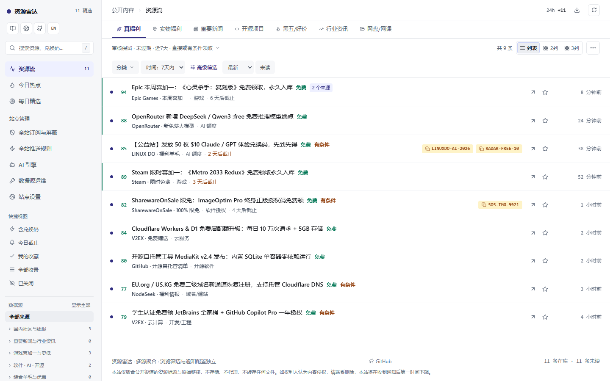
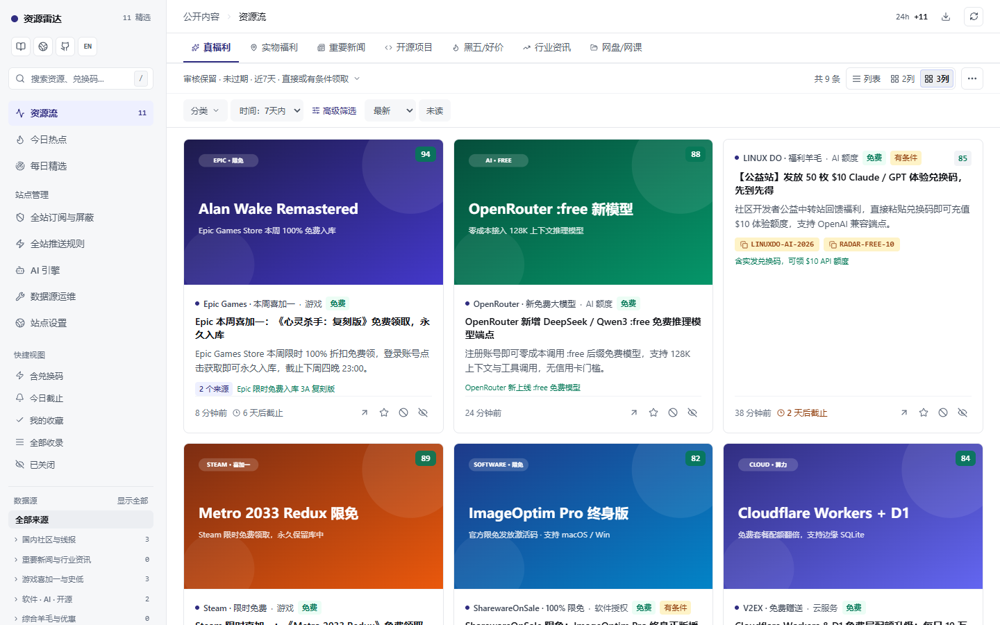
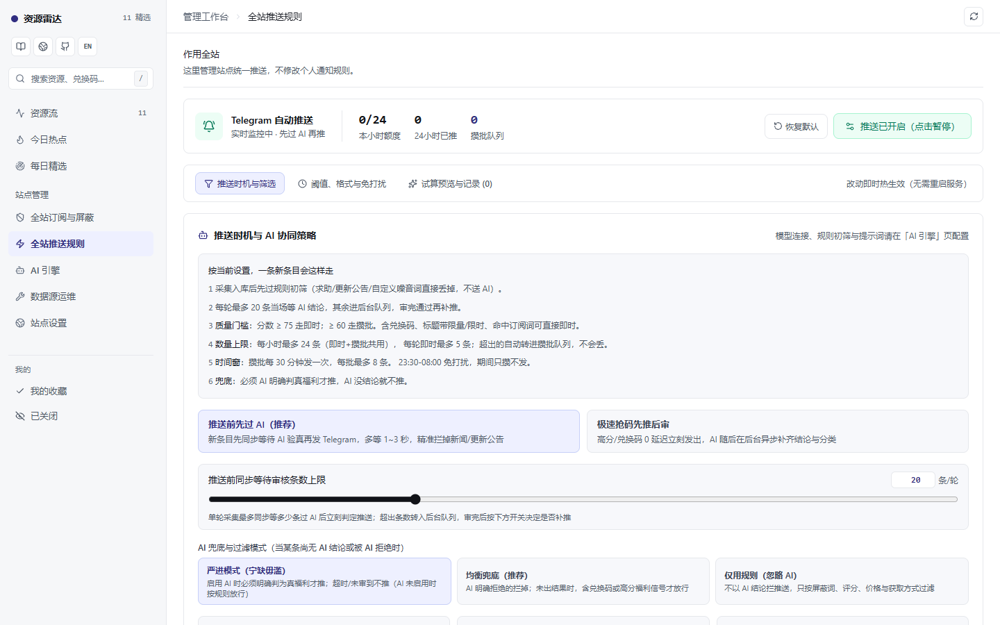
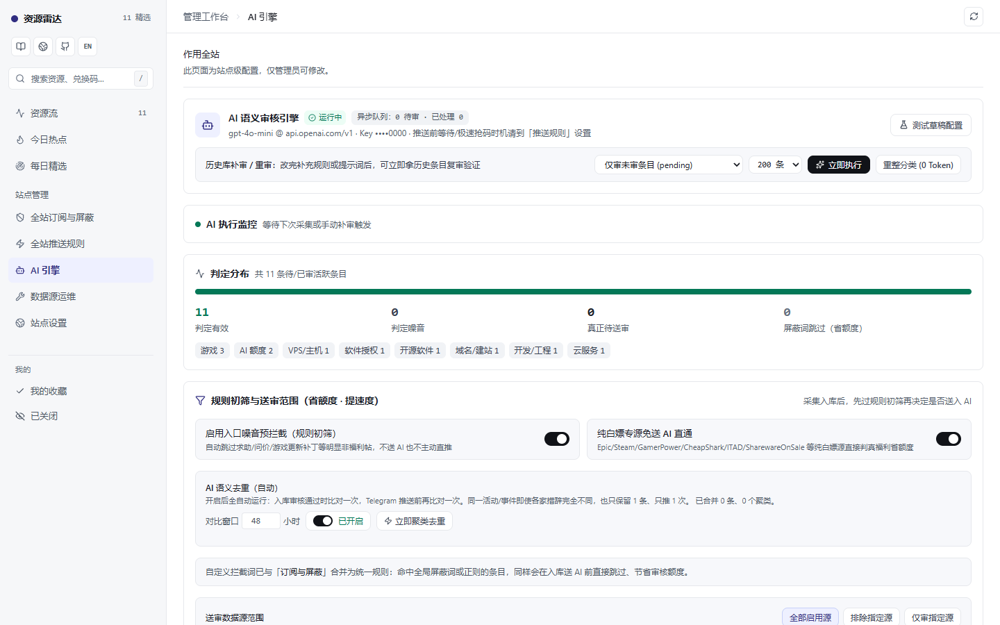
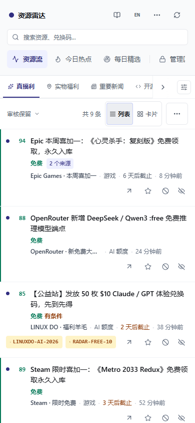

<div align="center">
  
  <h1>Resource Radar · 资源雷达</h1>
  <p><strong>Self-hosted multi-interest aggregator &amp; AI-routed radar for freebies, deals, group buys, open-source projects, and news</strong></p>
  <p>6 Content Kinds · 28 Channel-Aware Categories · Unified Blocklist · Multi-Route Telegram Push · Zero External DB</p>

  <p>
    <a href="README.md">简体中文</a> · <a href="README.en.md">English</a> · <a href="README.ja.md">日本語</a>
  </p>

  <p>
    
    <a href="https://hub.docker.com/r/zichuanlan/freebie-radar"></a>
    <a href="https://hub.docker.com/r/zichuanlan/freebie-radar"></a>
    
    
    
  </p>
</div>

---

**Resource Radar (`freebie-radar`)** is a lightweight, self-hosted workbench that aggregates, classifies, and routes items from developer communities, gaming platforms, software giveaway feeds, GitHub, Reddit, Bluesky, Telegram channels, and custom RSS feeds.

Instead of forcing every feed into a single freebie-only filter or dumping raw RSS noise, it separates **content kind** (`freebie | deal | opensource | news | info | noise`), **vertical category** (28 domains), and **obtain mode** (`free | conditional | lottery | trial | promo | paid`):

- Want **strictly verified freebies**? The default **Verified Freebies** channel stays locked to AI-verified `freebie` items (`free` + `conditional`), completely isolated from paid deals, carpools, secondhand listings, or news.
- Want **Black Friday VPS deals, carpool seats, open-source releases, or tech & major news**? Switch channels in one click to get channel-specific sub-categories, noise-free live counts, responsive image-card views, and dedicated Telegram push routes.

---

> Live Demo: <https://radar.zichuanlan.top> · Documentation: <https://zichuanlan.github.io/freebie-radar/>

---

## Screenshots

| Workbench List View (8 Interest Channels, Filters, Clustering & Code Copy) | 3-Column Visual Grid (Zero-Request Cover Extraction & List / 2 / 3 Cols) |
| :---: | :---: |
|  |  |

| Multi-Route Push Editor (Per-Topic Instant/Batch Routing & Diagnostics) | AI Semantic Engine (28-Category Routing, Learning & 0-Token Reclassify) |
| :---: | :---: |
|  |  |

| Mobile Responsive (<768px Collapsible Filters, List / Cards & Touch Targets) |
| :---: |
|  |

---

## Key Features

### 1. Multi-Interest Channels & Orthogonal Taxonomy (`kind × category × obtain`)
- **6 Content Kinds**: `freebie` (free giveaways & credits), `deal` (Black Friday VPS, historical lows, group-buy carpools, secondhand trades), `opensource` (GitHub & self-hosted tools), `news` (breaking headlines), `info` (industry news & guides), and `noise` (filtered chatter/requests).
- **28 Categories**: `ai`, `vps`, `cloud`, `domain`, `opensource`, `software`, `dev`, `design`, `security`, `hardware`, `media`, `game`, `carpool`, `trade`, `headline`, `world`, `finance`, `stock`, `tech`, `news`, `goods`, `offline`, `lottery`, `invite`, `edu`, `pan`, `course`, `other`.
- **Channel-Aware Sub-Categories**: 8 channels (Verified Freebies, All Freebies, Offline Perks, Cloud Drives & Courses, Deals, Open Source, Breaking News, Industry Info) each display only their relevant sub-categories with live noise-free counts; *Verified Freebies* excludes `carpool`, `trade`, `news`, `pan`, `course`, and `offline`. Switching channels automatically resets incompatible filters.
- **6 Obtain Modes**: Separates `free` and `conditional` from `lottery`, `trial` (including free demos), `promo`, and `paid`.

### 2. Unified Blocklist, AI Grading, Evidence Checks & Manual Override
- **Unified Blocklist Saves LLM Tokens**: Keyword/regex/per-source rules defined in **Subscriptions & Blocklist** hide items from the web feed, block pushes/digests, **and skip AI review & backfill** at ingestion time.
- **AI Semantic Review & Semantic Deduplication**: Works with any OpenAI-compatible endpoint; outputs `keep`, `kind`, `category`, `obtain`, `quality` (1–5), and a concise reason. Supports skipping pure-freebie sources, supplementary prompt rules, adaptive learning from starred/ignored items, and cross-source AI semantic deduplication before storage and push.
- **Evidence Guard & Single-Item Manual Override**: `enforceFreebieEvidence` rejects paid deals or news mislabeled as freebies; admins can override an item's category/kind directly in the detail drawer (**manual override > source fixed category > evidence guard > rules/AI**, protected by SQLite triggers) and run zero-token reclassification on historical items.

### 3. Responsive Views, URL-Synced Workspace & Zero-Request Covers
- Switch between **List**, **2 cols**, and **3 cols** with persistent layout preference (`< 768px` mobile simplifies to **List / Cards**); URL query & hash keep filters and views shareable across reloads and history navigation, paired with a prev/next detail drawer.
- Extracts cover images with zero extra HTTP requests across 14 collector paths (Epic, Steam, GamerPower, CheapShark, GOG, RSS `<media:content>` / ``, Telegram, LINUX DO, V2EX, Bilibili, Weibo, CCTV, Bluesky, local CDP) and collapses the media slot cleanly on text-only items.
### 4. Multi-Route Telegram Push
- Configure global rules or create/edit independent **Topic Push Routes** (e.g., Verified Freebies Instant, Black Friday VPS Deals, Open-Source Batch Digest, News Morning Brief) with per-route kinds, categories, obtain modes, keywords, price cap, min score, instant vs. batch mode, and custom header prefix.
- Supports **Wait for AI before pushing** or **Instant-first** with automatic backfill push, plus `strict` / `rule_fallback` / `ignore_ai` fallback modes, quiet hours, and pre-send DB/blocklist re-validation.

### 5. Lightweight Stack, Bilingual UI & Optional Public Multi-User Mode
- Runs native TypeScript on `node:24-alpine` with built-in `node:sqlite` (WAL mode, Schema v32 auto-migration, < 100MB typical memory).
- **Bilingual UI (Chinese / English)**: every UI string goes through `src/web/src/lib/i18n.ts` (zero-dependency, the Chinese text *is* the dictionary key). Non-Chinese browsers default to English on first visit; toggle in the sidebar/topbar or via `?lang=en`, verified by `pnpm i18n:check`.
- **116 Built-in Sources (67 High-Signal Curated Enabled by Default)** covering LINUX DO, NodeSeek, V2EX, NGA (deals/carpools/secondhand), Bilibili, Weibo, CCTV News, OpenRouter `:free` models, GitHub, Epic, Steam, GamerPower, CheapShark, ITAD, SharewareOnSale, TickCoupon, Reddit, Bluesky, Telegram channels and Chinese VPS promo blogs, plus custom RSS and local browser/Tampermonkey ingestion for login-gated sites (Zhihu, Xiaohongshu, Xiaoheihe).
- Set `ADMIN_TOKEN` (and optionally `ADMIN_HOSTS`) to keep browsing & daily digests public while protecting all configuration and mutation endpoints.
- **Optional Public Multi-User Mode**: set `SITE_MODE=public` with LINUX DO or GitHub OAuth to isolate starred/read/hidden items, blocklists, personal Telegram Bot / Webhook (e.g. QQ bridges), and personal RSS tokens per user — with invite codes, user quota caps, and explicit personal vs `?workspace=site` admin scope switching. See [docs/accounts.md](docs/accounts.md).

### 6. External Tools (Epic free-game claimer)
- **The claimer is a separate project.** Claiming Epic freebies involves a real browser session and hCaptcha, which does not belong in a 100MB radar process. It ships as its own service (own process, own database, own panel); this repo only links to it.
- Set `EPIC_CLAIMER_URL=https://your-claimer-host` and an **External Tools** card appears under Admin → Data sources → External Tools. Leave it unset and the card is not rendered — this project never claims anything itself.
---

## Quick Start

### Docker Compose (Recommended)

Don't want to build anything? The official image is on Docker Hub — **one `docker run` and you're up**, no clone needed:

```bash
docker run -d --name radar --restart unless-stopped \
  -p 127.0.0.1:8788:8788 \
  -v "$PWD/data:/data" \
  -e TZ=Asia/Shanghai \
  -e ADMIN_TOKEN=replace-with-your-own-24-char-secret \
  zichuanlan/freebie-radar:latest
```

Or pin a version through `RADAR_IMAGE` in `.env` (`latest` / `v1.1.0` / a git short SHA) so Compose pulls instead of building:

```bash
git clone https://github.com/ZiChuanLan/freebie-radar.git
cd freebie-radar

# Optional: customize ADMIN_TOKEN, Telegram bot, proxy, AI, etc.
cp .env.example .env
# Pin the image if you like; defaults to zichuanlan/freebie-radar:latest
echo "RADAR_IMAGE=zichuanlan/freebie-radar:latest" >> .env

docker compose pull
docker compose up -d
```

Building from source instead (you changed code, or don't care about the published image):

```bash
docker compose up -d --build
```

To also spin up **FlareSolverr** for Cloudflare-protected sources:

```bash
# Set FLARESOLVERR_URL=http://flaresolverr:8191 in .env
docker compose --profile cf up -d --build
```

Verify health & logs:

```bash
curl http://127.0.0.1:8788/health
# {"ok":true,"version":"1.1.0",...}
docker compose logs -f --tail 50
```

### Image tags

| Tag | Meaning |
|---|---|
| `latest` | Latest build |
| `v1.1.0` | Matches the GitHub release / git tag — pin this in production |
| `9191745` | The git short SHA at build time, for pinning or rolling back |

The image is a multi-stage `node:24-alpine` build that keeps only production dependencies and `dist/web`; steady-state memory is roughly 80–100 MiB.

Data persists in `./data/radar.db` (mounted at `/data/radar.db`). Upgrades: `docker compose pull && docker compose up -d` for the image, or `git pull && docker compose up -d --build` from source. Both run the SQLite migrations automatically.

### From Source (Node.js ≥ 22.5 + pnpm 10)

```bash
git clone https://github.com/ZiChuanLan/freebie-radar.git
cd freebie-radar

pnpm install
cp .env.example .env
pnpm build
pnpm start
```

Development mode:

```bash
pnpm dev        # Backend API :8788
pnpm dev:web    # Vite frontend :5173 (proxies /api to 8788)
```

### Deploy with AI (copy & paste)

Hand the prompt below to Claude Code / Codex / Cursor / ChatGPT with terminal access. It checks prerequisites, clones the repo, generates `ADMIN_TOKEN`, builds, and verifies every step before reporting back.

<details>
<summary><b>Expand: deployment prompt (copy as-is)</b></summary>

```text
Deploy freebie-radar (a self-hosted resource radar) on this server, following the steps below exactly.
Goal: the service listens on 127.0.0.1:8788 and curl http://127.0.0.1:8788/health returns {"ok":true,...}.

1) Preflight: docker + docker compose v2 available, >= 1GB RAM, >= 2GB free disk, port 8788 free; install docker if missing.
2) git clone https://github.com/ZiChuanLan/freebie-radar.git /opt/freebie-radar && cd /opt/freebie-radar
3) cp .env.example .env and change only: ADMIN_TOKEN=<generate a 24-char random string and report it>, TZ=Asia/Shanghai, BIND_ADDRESS=127.0.0.1
   (to collect Cloudflare sources like linux.do add: docker compose --profile cf up -d --build
    and set FLARESOLVERR_URL=http://flaresolverr:8191 in .env)
4) docker compose up -d --build
5) Verify - all must pass:
   - docker compose ps shows radar as running/healthy
   - curl -fsS http://127.0.0.1:8788/health returns ok:true
   - curl -fsS -o /dev/null -w '%{http_code}' http://127.0.0.1:8788/ returns 200
   - docker compose logs --tail 100 radar shows no error loop (ECONNREFUSED/EACCES/ENOSPC/SQLITE_BUSY)
   - trigger one manual collection in Admin -> Data sources and confirm items were ingested
6) Report: (1) URL (2) ADMIN_TOKEN (3) item count of the first collection (4) remaining warnings and why
Hard constraints: no commit/push, never let .env reach logs, do not touch pnpm-lock.yaml, never expose the port
while ADMIN_TOKEN is unset, no git reset --hard / git clean -fd, never delete ./data.
```

</details>

Full version with the verification checklist, failure playbook, backup and upgrade notes: [`docs/ai-deploy.md`](docs/ai-deploy.md).

---

## Configuration (`.env`)

Most policies (AI endpoint/model/prompts, multi-route push rules, block rules, source toggles/intervals, retention) are configured live in the Web Admin UI without restarts. Key process-level `.env` variables:

| Variable | Default | Description |
|---|---|---|
| `PORT` / `HOST` | `8788` / `0.0.0.0` | HTTP listen port and host |
| `DATABASE_PATH` | `./data/radar.db` | SQLite path (`/data/radar.db` in Docker) |
| `ADMIN_TOKEN` | empty (open) | Password protecting admin tabs & write endpoints |
| `FLARESOLVERR_URL` | empty | Optional FlareSolverr URL (e.g. `http://flaresolverr:8191`) |
| `HTTP_PROXY` / `HTTPS_PROXY` | empty | Outbound proxy for collectors |
| `PUSH_CHANNEL` | `none` | Set to `telegram` to enable Telegram push |
| `TELEGRAM_BOT_TOKEN` | empty | Telegram bot token (`@BotFather`) |
| `TELEGRAM_CHAT_ID` | empty | Target Telegram chat ID |
| `TELEGRAM_PROXY` | empty | Proxy used only for Telegram requests |
| `AI_BASE_URL` / `AI_API_KEY` / `AI_MODEL` | empty | Optional initial OpenAI-compatible LLM config |
| `INGEST_TOKEN` | empty | Bearer token for `POST /api/ingest` (`scripts/pw-collect.mjs` / userscript) |
| `GITHUB_TOKEN` | empty | Optional token raising GitHub API quota from 60/h to 5000/h |
| `ENABLE_SCHEDULER` | `true` | Enable built-in collection, batch push, digest & cleanup scheduler |
| `DAILY_CRON` / `DAILY_TOP_N` | `30 8 * * *` / `12` | Daily digest schedule and item count |
| `SITE_MODE` | `auto` | One switch for the whole deployment shape — see below |
| `GUEST_HIDDEN_CATEGORIES` | `pan,course` | Categories hidden from logged-out visitors on a public site; ignored in selfhost mode |

### Public site vs self-host: one variable

`SITE_MODE` decides the shape of the whole site; everything else follows automatically.

| | `SITE_MODE=selfhost` (personal) | `SITE_MODE=public` (public demo) |
|---|---|---|
| Login button | Hidden, no OAuth needed | Shown, LINUX DO / GitHub OAuth required |
| Starred / read / blocklist | Global, stored locally | Isolated per logged-in user |
| Drive & course categories | **All visible** | Hidden from logged-out visitors |
| Personal RSS / Telegram bot | Not needed | Every user can bind their own |

`auto` (the default) looks at whether OAuth credentials exist: configured → behaves as `public`, otherwise `selfhost`.

So a self-hosted install needs zero changes as long as OAuth stays empty; a public site just fills in the OAuth credentials and sets `SITE_MODE=public`. You never configure the login switch and category visibility separately — `GUEST_HIDDEN_CATEGORIES` only applies in `public` mode and is ignored under `selfhost`.
---

## CLI Utilities

```bash
pnpm tsx src/server/cli.ts sources              # List all 116 sources and run stats
pnpm tsx src/server/cli.ts collect [sourceId]   # Run collection immediately
pnpm tsx src/server/cli.ts enable <id...>       # Enable source(s)
pnpm tsx src/server/cli.ts disable <id...>      # Disable source(s)
pnpm tsx src/server/cli.ts config <id> <json>   # Update source config JSON
pnpm tsx src/server/cli.ts reclassify           # Re-run rule classification, evidence guard & dedupe keys
pnpm tsx src/server/cli.ts ai-review [limit]    # Backfill AI review on pending items
pnpm tsx src/server/cli.ts daily [--dry-run]    # Run or preview daily digest
pnpm tsx src/server/cli.ts digests              # List recent daily digest dates
pnpm tsx src/server/cli.ts stats                # Show per-category statistics
pnpm tsx src/server/cli.ts diagnose             # Diagnose push filter hits & drops
pnpm tsx src/server/cli.ts obtain [--all]       # Recompute obtain modes with evidence checks
```
## Login-gated collection (Zhihu / Xiaohongshu / Xiaoheihe)

These three sites rely on a logged-in browser session and front-end request signing, so they are collected by `scripts/pw-collect.mjs` using a persistent Chrome profile — on your laptop or on a desktop-equipped remote server.

- **Local loopback login service (recommended)**: run `node scripts/pw-collect.mjs serve`, then click *Scan to log in* under Admin → Data sources, scan with your phone and the collector grabs public posts and pushes them back. You can also copy the Tampermonkey userscript the page offers — no Node/Playwright needed.
- **Scheduled script on a server**:
  ```bash
  PROFILE_DIR=/data/profile SERVER_URL=http://127.0.0.1:8788 HEADLESS=1 INGEST_TOKEN=your_token node scripts/pw-collect.mjs
  ```
- **Privacy boundary**: the radar never stores cookies or account credentials; the session lives only in your local `PROFILE_DIR`.

---

## Documentation

Full documentation site: <https://zichuanlan.github.io/freebie-radar/>

- [`docs/deploy.md`](docs/deploy.md) — deployment, FlareSolverr & operations commands
- [`docs/ai-deploy.md`](docs/ai-deploy.md) — hand deployment to an AI agent, with a verification checklist
- [`docs/security.md`](docs/security.md) — public deployment, reverse proxy, rate limits & admin isolation
- [`docs/accounts.md`](docs/accounts.md) — public multi-user mode: LINUX DO / GitHub OAuth, personal Bot / Webhook & RSS
- [`docs/data-sources.md`](docs/data-sources.md) — the 116 sources and their reachability
- [`docs/classification.md`](docs/classification.md) — fixed categories, RSS filters, evidence checks & manual overrides
- [`docs/obtain.md`](docs/obtain.md) — the `free` / `conditional` / `lottery` / `trial` / `promo` / `paid` obtain ladder
- [`docs/ai.md`](docs/ai.md) — AI semantic review rules and misclassification control
- [`docs/push.md`](docs/push.md) — multi-route push tiers, timing, dedupe and quiet hours
- [`docs/workspace-architecture.md`](docs/workspace-architecture.md) — UI pages, URL state, request scoping & component boundaries
- [`docs/ui-review.md`](docs/ui-review.md) — UI workflows, visual hierarchy & interaction audit
- [`CHANGELOG.md`](CHANGELOG.md) — release notes

---

## Disclaimer & License

- This project only aggregates, filters and deduplicates publicly available web pages and APIs. It does not store or redistribute copyrighted content and does not provide account sharing; please respect each target site's terms of service and keep crawl rates reasonable.
- Open source under the [MIT License](LICENSE). If it helps you, a ⭐ star is appreciated!
- Thanks to [LinuxDo](https://linux.do) and to everyone who reported issues, contributed source adapters or improved the code.
