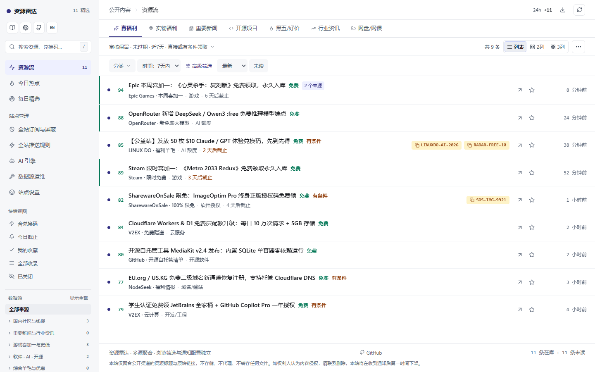
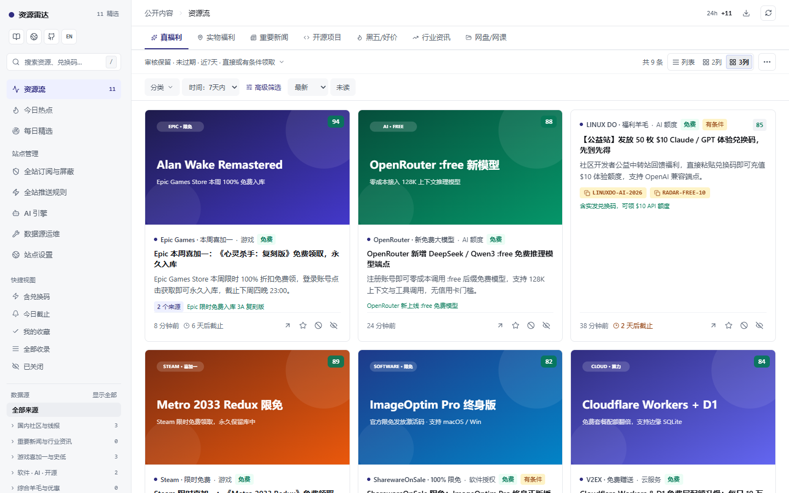
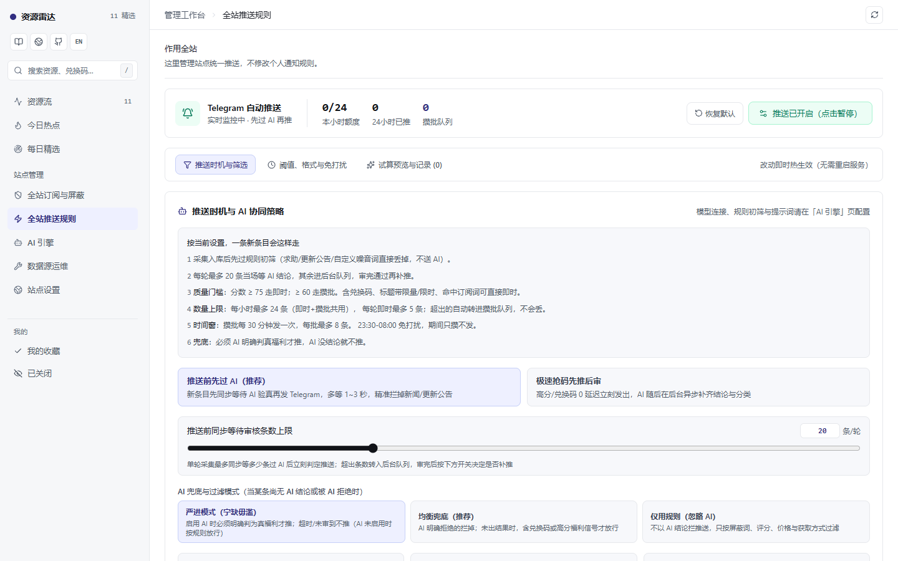
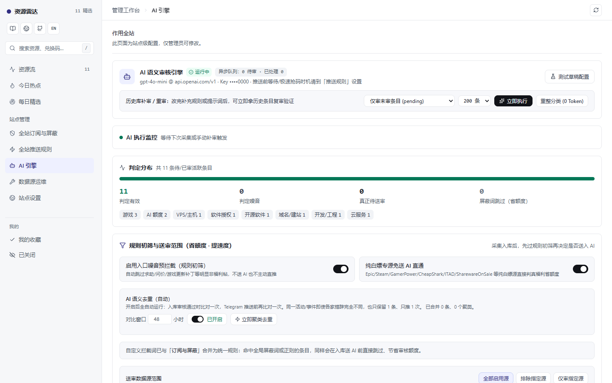
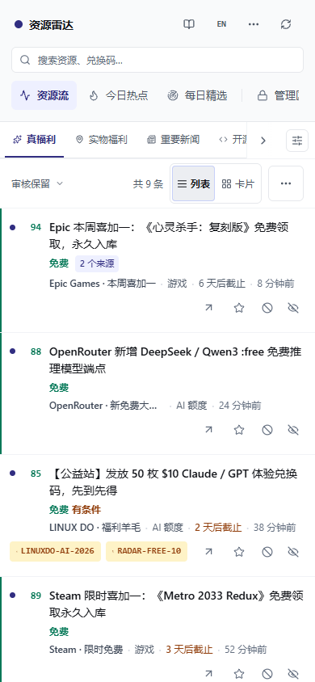
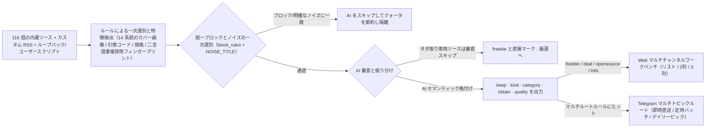

<div align="center">
  
  <h1>Resource Radar · 資源レーダー</h1>
  <p><strong>フリビー・セール・相乗り取引・オープンソース・ニュースを横断するマルチ興味対応のセルフホスト型アグリゲーションレーダー</strong></p>
  <p>6 種類のコンテンツ形態で振り分け · 28 カテゴリのチャンネル別ディレクトリ · 統一ブロックリストでクォータ節約 · AI によるセマンティック格付け · マルチルート高精度プッシュ通知</p>

  <p>
    <a href="README.md">简体中文</a> · <a href="README.en.md">English</a> · <a href="README.ja.md">日本語</a>
  </p>

  <p>
    <a href="https://github.com/ZiChuanLan/freebie-radar/releases"></a>
    
    <a href="https://hub.docker.com/r/zichuanlan/freebie-radar"></a>
    <a href="https://hub.docker.com/r/zichuanlan/freebie-radar"></a>
    
    
    
  </p>
</div>

---

**資源レーダー（Resource Radar / repo: `freebie-radar`）** は、軽量ですぐに使えるマルチ興味コミュニティ情報のアグリゲーション＆高精度プッシュ通知ワークベンチです。開発者コミュニティ、ゲームプラットフォーム、ソフトウェア無料配布サイト、GitHub、Reddit、Bluesky、Telegram チャンネル、カスタム RSS から情報を収集し、**「ルールによる一次選別と統一ブロック → AI によるセマンティック格付けと振り分け → チャンネル別ディレクトリ表示 → マルチルート高精度プッシュ通知」** で、各コンテンツを本来あるべき場所へ届けます：

- 純粋にフリビーだけを追いたい？ ホーム画面はデフォルトで **「厳選フリビー」** チャンネルが AI 検証済みの `freebie`（直接タダ取りできるもの + 実践で受け取れる条件付きフリビー）に厳密に固定され、有料セール・相乗り・中古・ニュースが混入しません。
- **ブラックフライデーの VPS セール / 合法な相乗り / オープンソースプロジェクト / 重大ニュースとテック情報** を見たい？ 上部の興味チャンネルをワンクリックで切り替えれば、それぞれ専用の下位カテゴリ、実際の有効件数、画像付きカードを閲覧でき、互いに干渉しない Telegram トピック別プッシュルートを個別に設定できます。

---

> オンラインデモ：<https://radar.zichuanlan.top> · ドキュメントサイト：<https://zichuanlan.github.io/freebie-radar/>

---

## 画面プレビュー

| ワークベンチのリスト表示（8 つの興味チャンネル + 詳細フィルタ + ソース横断の折りたたみ + 引換コードのワンクリックコピー） | 3 列の画像付きカード表示（追加リクエストなしのカバー画像抽出 + レスポンシブな リスト / 2列 / 3列 切替） |
| :---: | :---: |
|  |  |

| マルチルート高精度プッシュ通知（形態 / カテゴリ / 入手方法 / キーワード別に即時またはバッチ配信するルートを設定） | AI セマンティックエンジン（28 カテゴリへの振り分け、適応学習、0 トークンでの既存データ再分類） |
| :---: | :---: |
|  |  |

| モバイルレスポンシブ表示（折りたたみ可能なチャンネル・フィルタパネル · リスト / カード切替） |
| :---: |
|  |


---

## 主な機能

### 1. マルチ興味チャンネルと「形態 × 領域 × 入手方法」の直交分類
- **6 種類のコンテンツ形態（`kind`）**：`freebie`（タダ取りフリビー）、`deal`（特価セール・ブラックフライデーの VPS / 相乗り / 中古の出品を含む）、`opensource`（オープンソースプロジェクト）、`news`（重大ニュース）、`info`（業界情報・ガイド）、`noise`（単なる質問・雑談などのノイズ）。
- **27 個の垂直領域（`category`）**：`ai`（AI クォータ）、`vps`（VPS / レンタルサーバー）、`cloud`（クラウドサービス）、`domain`（ドメイン / サイト構築）、`opensource`（オープンソースソフトウェア）、`software`（ソフトウェアライセンス）、`dev`（開発 / エンジニアリング）、`design`（デザイン / 素材）、`security`（セキュリティ / ネットワーク）、`hardware`（ハードウェア / デジタル機器）、`media`（動画・音楽のサブスク）、`game`（ゲーム）、`carpool`（相乗り / シェア）、`trade`（中古 / 売買）、`headline`（政治・時事の重要ニュース）、`world`（国際ニュース）、`finance`（経済 / ビジネス）、`stock`（株式 / マーケット）、`tech`（テック動向）、`news`（総合情報）、`goods`（実物 / お得情報）、`offline`（実物フリビー）、`invite`（招待コード）、`edu`（教育 / 試験）、`pan`（クラウドストレージ資産）、`course`（オンライン講座 / チュートリアル）、`other`（その他）。
- **8 個の興味チャンネルと適応的な下位カテゴリ**：厳選フリビー、すべてのタダ取り、実物フリビー、クラウドストレージ / オンライン講座、セール、オープンソース、重大ニュース、業界情報；
  - 「厳選フリビー / すべてのタダ取り」はフリビー系のカテゴリのみを表示します（相乗り / 売買 / ニュースは非表示、クラウドストレージ / オンライン講座 / 実物フリビーはそれぞれ独立したチャンネル）。統計件数は `noise` の水増し分をリアルタイムに除外します；
  - 「重大ニュース / 業界情報」は自動的にニュース欄の視点に切り替わります（政治・時事、国際ニュース、経済 / ビジネス、株式 / マーケット、テック最前線、AI 最前線、開発エンジニアリング、オープンソースエコシステム、セキュリティ / 脆弱性、ハードウェア・デジタル、総合情報）；
  - チャンネルを切り替えると、互換性のない形態・入手方法・価格上限が自動的にリセットされ、空の画面や状態の混線を防ぎます。
- **6 段階の入手方法（`obtain`）**：`free`（直接タダ取り）、`conditional`（条件付き）、`lottery`（抽選）、`trial`（トライアル / Demo）、`promo`（プロモーション / 送客）、`paid`（有料）を厳密に区別します。

### 2. 3 層の高 S/N 比ガバナンス（統一ブロック · AI 格付け · 証拠検証と手動補正）
- **統一ブロックリストのファイアウォール（クォータ節約 + Web 非表示 + プッシュ遮断）**：「購読とブロック」でキーワード・正規表現・ソース別ルールを設定すると、Web 上の項目の非表示、プッシュとデイリーピックの遮断だけでなく、**収集して DB に入れて AI 審査に送る前および過去分の再審査の前にもスキップ**されるため、2 か所で重複設定する必要がありません。
- **AI セマンティック審査と意味的重複排除**：任意の OpenAI 互換 API に対応し、1 回の出力で `keep`、`kind`、`category`、`obtain`、`quality`（1〜5 つ星）と中国語の理由を返します。タダ取り専用ソースの審査スキップ、追加の補足ルール、スター / 非表示からの個人嗜好の自動学習、および保存・プッシュ前の AI 意味的重複排除に対応します。
- **分類証拠の検証と単一項目の手動補正**：`enforceFreebieEvidence` により有料セールやニュースがフリビーに混入するのを防ぎます。管理者は詳細ドロワーから単一項目のカテゴリと形態を上書きでき、優先順位は **手動補正 > ソース固定カテゴリ > 証拠検証 > ルール / AI**（SQLite トリガーで上書き保護）に従い、0 トークンでの既存データ再分類も利用できます。

### 3. 3 種類のレスポンシブ表示・URL 状態同期・追加リクエストなしのカバー画像抽出
- **リスト / 2列 / 3列** をワンクリックで切り替え、設定を記憶します（`< 768px` のモバイルでは **リスト / カード** に自動収束）。URL クエリとハッシュによりフィルタ条件と画面状態を共有・ブラウザ履歴で前後移動でき、前後項目を切り替えられる詳細ドロワーも備えています。
- 14 系統のコレクター（Epic / Steam / GamerPower / CheapShark / GOG / RSS `<media:content>` & `` / Telegram / LINUX DO / V2EX / B站 / 微博 / CCTV / Bluesky / ローカルループバック）が追加リクエストなしでカバー画像を抽出し、テキストのみの項目はカバー領域を自動的に畳んでグリッドの穴を防ぎます。
### 4. マルチルート高精度 Telegram プッシュ通知
- **グローバル戦略 + マルチトピックルート**：独立したルートのワンクリック追加やビジュアル編集に対応（例：「🎁 厳選フリビー直送」「🖥 ブラックフライデー / VPS 即時通知」「📦 オープンソースのバッチまとめ」「📰 ニュース・情報の朝刊」）。各ルートごとに形態、カテゴリ、入手方法、キーワード、最高価格、最低スコア、即時 / バッチモード、カスタム接頭辞を個別に設定できます。
- **プッシュのタイミングとフォールバック**：「プッシュ前に AI を通す（誤送防止）」と「高速でコードを取るため先に送って後から審査（バックグラウンド審査後に自動で追送）」に対応。`strict` / `rule_fallback` / `ignore_ai` の 3 種類の AI フォールバックモードを用意しています。
- **誤送防止の二重チェックと診断プレビュー**：バッチ送信前に DB の状態と最新のブロックリストを再確認します。遮断理由の分布表示とルートヒットのプレビューに対応。夜間のサイレント時間帯と多言語 / 鮮度ゲートを内蔵しています。

### 5. ミニマルなデプロイと単一パスワード認証の領域分離
- **外部データベース不要**：`node:24-alpine` 上で TypeScript をネイティブ実行し、`node:sqlite` を内蔵（WAL モード + メモリ上限のチューニング、Schema v32 まで自動インクリメンタル移行）。日常運用時のメモリは 100MB 未満です。
- **中英 2 言語 UI**：UI 文言はすべて `src/web/src/lib/i18n.ts` を通します（依存ゼロ、中国語がそのまま辞書キー）。非中国語ブラウザの初回アクセス時は自動的に英語になり、トップバー / サイドバーのボタンや `?lang=en` で切り替え可能で、`pnpm i18n:check` によるカバレッジ検査も内蔵しています。
- **116 個の内蔵データソース（うち厳選された 67 個がデフォルトで有効）**：LINUX DO、NodeSeek（フリビー / 情報 / 相乗り売買板を含む）、V2EX、NGA（セール / 相乗り / 中古）、B站、微博、CCTV ニュース、OpenRouter の `:free` モデル、GitHub、Epic、Steam、GamerPower、CheapShark、ITAD、SharewareOnSale、TickCoupon、Reddit、Bluesky、Telegram チャンネル、中国の VPS 系プロモブログをカバーし、カスタム RSS とローカルループバック / ユーザースクリプトによる知乎 / 小红书 / 小黑盒 の収集にも対応します。
- **公開 / 管理の分離**：`ADMIN_TOKEN` を設定すると、リソースフィード、今日のホットトピック、デイリーピックは公開閲覧のまま、管理設定と書き込み系 API はすべて自動的に認証で保護されます（`ADMIN_HOSTS` による専用管理ドメインの限定にも対応）。
- **任意の公開マルチユーザーモード**：`SITE_MODE=public` + LINUX DO / GitHub OAuth を設定すると、公開コンテンツは引き続き読み取り専用で共有されますが、「見たくない / スター / 既読 / ブロックワード / 注目ワード」はログインユーザーごとに分離されます（招待コード登録や登録枠上限に対応）。未ログインの訪問者の嗜好はそのブラウザにのみ保存されます。ログインユーザーは自分の Telegram Bot や Webhook（QQ ブリッジ等）を紐付けて個人向けプッシュ通知を受け取ることも、公開 RSS や個人専用 RSS を購読することもでき、`?workspace=site` で個人設定とサイト全体管理を明示的に切り替えられます。詳細は [docs/accounts.md](docs/accounts.md) を参照してください。

### 7. ダークモード

システム / ライト / ダークの 3 状態。ダークはセマンティック token を差し替えるだけで、コンポーネントを二重に持たない。サイドバーとモバイルバーの 2 か所の入り口は常に同期します。

### 6. 外部ツール入口（Epic 無料配布ゲームの受け取りツール）
- **受け取りツールは独立したプロジェクトです**：Epic の自動受け取りはブラウザと hCaptcha の突破を伴い、規模も実行環境もレーダーに押し込むのに向いていません。別途デプロイされ（独立プロセス、独立データベース、専用パネル）、レーダー側は「データソース運用」パネルに入口を 1 つ用意するだけです。
- `EPIC_CLAIMER_URL=https://あなたの受け取りツールのアドレス` を設定すると「データソース運用 → 外部ツール」にカードが表示されます。設定しなければこのブロックは表示されず、レーダーは一切の受け取り処理を行いません。
---

## ワークフロー構成



---

## クイックスタート（すぐ使える）

### 方法 1：Docker Compose（推奨、1 分で起動）

ビルドしたくない場合は、公式イメージが Docker Hub に公開されています。**`docker run` 1 回で起動でき、clone も不要**です：

```bash
docker run -d --name radar --restart unless-stopped \
  -p 127.0.0.1:8788:8788 \
  -v "$PWD/data:/data" \
  -e TZ=Asia/Shanghai \
  -e ADMIN_TOKEN=あなた自身の24桁ランダム文字列 \
  zichuanlan/freebie-radar:latest
```

`.env` の `RADAR_IMAGE` でバージョンを固定すれば（`latest` / `v1.1.4` / git 短縮 SHA）、Compose はビルドせず pull します：

```bash
git clone https://github.com/ZiChuanLan/freebie-radar.git
cd freebie-radar

# 任意：環境変数をコピーして編集（ADMIN_TOKEN 管理パスワード、Telegram プッシュ通知、AI など）
cp .env.example .env
# 必要ならバージョンを固定（既定は zichuanlan/freebie-radar:latest）
echo "RADAR_IMAGE=zichuanlan/freebie-radar:latest" >> .env

docker compose pull
docker compose up -d
```

ソースからビルドしたい場合（コードを変更した、公開イメージを使わない）はこちら：

```bash
docker compose up -d --build
```

> **Cloudflare のシールド付きサイト（LINUX DO など）を収集したい場合**
> リポジトリには任意の `cf` profile が内蔵されており、1 コマンドで FlareSolverr も同時に起動できます：
> ```bash
> # .env に FLARESOLVERR_URL=http://flaresolverr:8191 を設定
> docker compose --profile cf up -d --build
> ```

ヘルス状態とログの確認：

```bash
curl http://127.0.0.1:8788/health
# {"ok":true,"version":"1.1.4",...}

docker compose logs -f --tail 50
```

### イメージタグ

| タグ | 意味 |
|---|---|
| `latest` | 最新ビルド |
| `v1.1.4` | GitHub Release / git tag に対応。本番はこのタグで固定するのがおすすめ |
| `19eb371` | ビルド時点の git 短縮 SHA。特定コミットへの固定・ロールバック用 |

イメージは `node:24-alpine` のマルチステージビルドで、実行時は本番依存と `dist/web` のみを保持します。常駐メモリは約 80〜100 MiB です。

データベースは `./data/radar.db`（コンテナ内 `/data/radar.db`）に保存されます。アップグレードはイメージなら `docker compose pull && docker compose up -d`、ソースからなら `git pull && docker compose up -d --build` で、どちらもデータベース移行が自動で完了し、データは一切失われません。

### 方法 2：ソースから実行（Node.js ≥ 22.5 + pnpm 10）

```bash
git clone https://github.com/ZiChuanLan/freebie-radar.git
cd freebie-radar

pnpm install
cp .env.example .env      # 必要に応じて ADMIN_TOKEN / プロキシ / Telegram などを記入
pnpm build                # フロントエンドの成果物を dist/web にビルド
pnpm start                # 自動作成・移行 + 116 個のデータソース初期化 + :8788 で起動
```

開発モード（フロントエンドとバックエンドのホットリロード）：

```bash
pnpm dev        # バックエンド API :8788
pnpm dev:web    # フロントエンド Vite :5173（/api を 8788 へ自動プロキシ）
```

### 方法 3：AI にデプロイを任せる

以下をそのまま Claude Code / Codex / Cursor / ChatGPT（ターミナル付き）に渡してください。環境を確認し、コードを取得し、`ADMIN_TOKEN` を生成し、ビルドし、1 項目ずつ検収したうえで、最後にアドレスとパスワードを報告してくれます：

<details>
<summary><b>展開：日本語のデプロイ指示（そのままコピー可）</b></summary>

```text
このサーバーに freebie-radar（セルフホスト型のリソースアグリゲーションレーダー）をデプロイしてください。以下の手順を順番に実行し、手順を飛ばさないこと。
目標：サービスが 127.0.0.1:8788 で動作し、curl http://127.0.0.1:8788/health が {"ok":true,...} を返すこと。

1) 環境チェック：docker と docker compose v2 が利用可能、メモリ ≥ 1GB、ディスク ≥ 2GB、8788 ポートが空いていること。docker が無ければインストールする。
2) git clone https://github.com/ZiChuanLan/freebie-radar.git /opt/freebie-radar && cd /opt/freebie-radar
3) cp .env.example .env を実行し、次の 3 項目だけを変更する：ADMIN_TOKEN=<24 桁のランダム文字列を生成して報告>、TZ=Asia/Shanghai、BIND_ADDRESS=127.0.0.1
   （linux.do のような Cloudflare サイトを収集する場合はさらに：docker compose --profile cf up -d --build を実行し、
     .env に FLARESOLVERR_URL=http://flaresolverr:8191 を設定する）
4) docker compose up -d --build
5) 検収。すべて合格して初めて完了とする：
   - docker compose ps で radar が running/healthy であること
   - curl -fsS http://127.0.0.1:8788/health が ok:true を返すこと
   - curl -fsS -o /dev/null -w '%{http_code}' http://127.0.0.1:8788/ が 200 を返すこと
   - docker compose logs --tail 100 radar に繰り返しエラーが出ていないこと（ECONNREFUSED/EACCES/ENOSPC/SQLITE_BUSY）
   - 管理画面の「データソース運用」で手動収集を 1 回実行し、項目が DB に入ることを確認する
6) 報告：①アクセス先アドレス ②ADMIN_TOKEN ③初回収集の件数 ④未解消の警告とその原因
制約：commit/push をしない、.env をログに出さない、pnpm-lock.yaml を変更しない、ADMIN_TOKEN 未設定のまま公衆に公開しない、
      git reset --hard / git clean -fd を実行しない、./data を削除しない。
```

</details>

英語の指示、検収チェックリスト表、よくある失敗への対処、デプロイ後のバックアップとアップグレードの説明を含む完全版：[`docs/ai-deploy.md`](docs/ai-deploy.md)。

---

## 環境変数の説明（`.env`）

すべての方針設定（AI モデル / プロンプト / 一次選別スイッチ、マルチルートプッシュ通知 / サイレント時間帯、ブロックワード、データソースの有効化と周期、データ保持日数）は**Web 管理画面でリアルタイムに反映されるホット設定**であり、`.env` で気にする必要があるのはプロセスレベルの環境変数だけです：

| 変数名 | デフォルト値 | 説明 |
|---|---|---|
| `PORT` / `HOST` | `8788` / `0.0.0.0` | HTTP の待ち受けポートとアドレス |
| `DATABASE_PATH` | `./data/radar.db` | SQLite のパス（Docker 内では固定で `/data/radar.db`） |
| `ADMIN_TOKEN` | 空欄（オープン） | 管理画面のパスワード；**公衆に公開する場合は強力なパスワードの設定を強く推奨** |
| `FLARESOLVERR_URL` | 空欄 | FlareSolverr のアドレス。例：`http://flaresolverr:8191` |
| `HTTP_PROXY` / `HTTPS_PROXY` | 空欄 | 収集の出口プロキシ（海外サーバーでは空欄で可） |
| `PUSH_CHANNEL` | `none` | `telegram` を設定するとプッシュ通知が有効になる |
| `TELEGRAM_BOT_TOKEN` | 空欄 | Telegram Bot Token（`@BotFather` で取得） |
| `TELEGRAM_CHAT_ID` | 空欄 | プッシュ通知を受け取る個人 / グループの Chat ID |
| `TELEGRAM_PROXY` | 空欄 | Telegram プッシュ通知のみに使うプロキシ |
| `AI_BASE_URL` / `AI_API_KEY` / `AI_MODEL` | 空欄 | 初回起動時のデフォルト AI パラメータ。以降は Web の「AI エンジン」で変更することを推奨 |
| `INGEST_TOKEN` | 空欄（書き込み禁止） | `scripts/pw-collect.mjs` やユーザースクリプトがデータを送り返すための Bearer Token |
| `GITHUB_TOKEN` | 空欄 | 任意。GitHub の収集レート制限を 60/h から 5000/h に引き上げる |
| `ENABLE_SCHEDULER` | `true` | 内蔵の収集、バッチ、デイリーピック、クリーンアップのスケジューラを有効にするか |
| `DAILY_CRON` / `DAILY_TOP_N` | `30 8 * * *` / `12` | デイリーピックの生成時刻と件数 |
| `SITE_MODE` | `auto` | **デプロイ形態をワンクリックで切り替え**。下記の説明を参照 |
| `GUEST_HIDDEN_CATEGORIES` | `pan,course` | 公開サイトで未ログイン訪問者に非表示にするカテゴリ；セルフホストモードでは自動的に無効 |

### 公開サイト vs セルフホスト：変数 1 つだけ

`SITE_MODE` がサイト全体の形態を決め、他の設定は自動的にそれに追従します：

| | `SITE_MODE=selfhost`（セルフホスト個人利用） | `SITE_MODE=public`（公開デモサイト） |
|---|---|---|
| ログインボタン | 表示しない。OAuth 設定不要 | 表示する。LINUX DO / GitHub OAuth の設定が必要 |
| スター / 既読 / ブロックワード | 全体で共有、ローカルに保存 | ログインユーザーごとに分離 |
| クラウドストレージ / オンライン講座カテゴリ | **すべて表示** | 未ログインの訪問者には非表示 |
| 個人 RSS / Telegram Bot | 不要 | 各ユーザーが自分のものを紐付け可能 |

`auto`（デフォルト）は OAuth が設定されているかを見ます：設定があれば `public` として動作し、無ければ `selfhost` として動作します。

つまりセルフホストなら OAuth 認証情報を入れない限り何も変更不要で、公開サイトにしたい場合は OAuth を設定して `SITE_MODE=public` を指定するだけです。**ログインスイッチとカテゴリの可視性を別々に設定する必要はありません** — `GUEST_HIDDEN_CATEGORIES` は `public` モードでのみ有効で、`selfhost` では自動的に無視されます。

公開サイトでクラウドストレージ / オンライン講座カテゴリも公開したい場合（著作権・コンプライアンスの責任はご自身で負うことになります）は、`GUEST_HIDDEN_CATEGORIES=`（空値）を設定してください。

---

## ログイン必須サイトの収集（知乎 / 小红书 / 小黑盒）

これら 3 つのサイトはブラウザのログイン状態とフロントエンドの署名に依存するため、`scripts/pw-collect.mjs` を使って永続化された Chrome Profile で動作します。ローカルマシンでも、GUI デスクトップのあるリモートサーバーでも利用できます：

- **ローカルループバックのログインサービス（推奨）**：`node scripts/pw-collect.mjs serve` を実行し、Web の「データソース運用」で「QR コードでログイン」をクリックしてログインウィンドウを開き、QR コードをスキャンします。ログイン後、公開投稿を自動で取得してレーダーへ送り返します。ページが提供する **Tampermonkey ユーザースクリプト** をコピーして使うこともでき、ローカルに Node / Playwright をインストールする必要はありません。
- **サーバー上の定期実行スクリプト**：
  ```bash
  PROFILE_DIR=/data/profile SERVER_URL=http://127.0.0.1:8788 HEADLESS=1 INGEST_TOKEN=your_token node scripts/pw-collect.mjs
  ```
- **プライバシーの境界**：サーバー側は Cookie もアカウント認証情報も一切保存せず、ログイン状態はローカルの `PROFILE_DIR` にのみ残ります。

---

## よく使う CLI ツール

```bash
pnpm tsx src/server/cli.ts sources              # 116 個のデータソースと直近の実行状況を一覧表示
pnpm tsx src/server/cli.ts collect [sourceId]   # 即時収集（指定なしなら有効な全ソースを実行）
pnpm tsx src/server/cli.ts enable <id...>       # 指定したソースを有効化
pnpm tsx src/server/cli.ts disable <id...>      # 指定したソースを無効化
pnpm tsx src/server/cli.ts config <id> <json>   # 指定したソースの設定を更新
pnpm tsx src/server/cli.ts reclassify           # ルール分類、スコア、証拠検証、二言語重複排除キーを再実行
pnpm tsx src/server/cli.ts ai-review [limit]    # 未審査の項目をまとめて再審査
pnpm tsx src/server/cli.ts daily [--dry-run]    # デイリーピックを生成またはプレビュー
pnpm tsx src/server/cli.ts digests              # 過去のデイリーピックの日付を一覧表示
pnpm tsx src/server/cli.ts stats                # カテゴリ別の統計を表示
pnpm tsx src/server/cli.ts diagnose             # プッシュの絞り込みとヒットの診断
pnpm tsx src/server/cli.ts obtain [--all]       # 入手方法と証拠ルール別に統計を再計算
```

---

## ディレクトリ構成と関連ドキュメント

```text
src/
├── shared/            # フロント・バックエンド共通の分類(28)、形態(6)、入手方法(6)、チャンネルクエリ定義
├── server/
│   ├── collectors/    # コレクターとスケジューラ（116 個の SEEDS / dispatchFresh / カバー画像抽出）
│   ├── enrich/        # 正規化、二言語重複排除、28 カテゴリのルール、証拠検証、形態/入手方法の振り分け、AI キューとブロックワード
│   ├── push.ts        # マルチルートの振り分け、Telegram 即時/バッチの二重チェック、サイレント時間帯、プレビュー診断
│   ├── digest.ts      # デイリーピックの生成とフォーマット
│   ├── retention.ts   # データ保持ポリシーと自動クリーンアップ
│   ├── ai-admin.ts    # AI 管理、過去分の再審査、0 トークンでの既存データ再分類
│   └── routes.ts      # Hono REST API と単一パスワード認証の領域分離
└── web/               # React 19 + Vite + Tailwind v4 ワークベンチ（URL 同期フィルタ · 個人/サイトスコープ · リスト/2列/3列表示 + マルチルートエディタ）
```

関連ドキュメントは `docs/` にあります（全体ナビゲーション：[ドキュメントサイト](https://zichuanlan.github.io/freebie-radar/)）：
- [`docs/deploy.md`](docs/deploy.md) — デプロイ、FlareSolverr と運用コマンド
- [`docs/ai-deploy.md`](docs/ai-deploy.md) — AI にワンクリックデプロイを任せる：コピー可能なデプロイ Prompt、検収チェックリスト、よくある失敗への対処
- [`docs/security.md`](docs/security.md) — 公開デプロイとセキュリティ境界（リバースプロキシ、レート制限、管理ドメイン分離）
- [`docs/accounts.md`](docs/accounts.md) — 公開マルチユーザーモード：LINUX DO / GitHub ログイン、個人分離、個人 Bot / Webhook と RSS
- [`docs/data-sources.md`](docs/data-sources.md) — データソース一覧と到達性の説明
- [`docs/classification.md`](docs/classification.md) — 固定カテゴリ、RSS フィルタ、証拠検証と単一項目の手動補正
- [`docs/obtain.md`](docs/obtain.md) — 入手方法（`free` / `conditional` / `lottery` / `trial` / `promo` / `paid`）の格付け体系
- [`docs/ai.md`](docs/ai.md) — AI セマンティック審査の基準と誤判定の対策
- [`docs/push.md`](docs/push.md) — マルチルートプッシュ通知の階層別振り分け、タイミング、重複排除、サイレント時間帯
- [`docs/workspace-architecture.md`](docs/workspace-architecture.md) — 画面構成、URL 状態、リクエストスコープとコンポーネント責務
- [`docs/ui-review.md`](docs/ui-review.md) — 操作フロー、視覚的階層とインタラクション連動の検証
- [`CHANGELOG.md`](CHANGELOG.md) — バージョン変更履歴

---

## 免責事項とライセンス

- 本プロジェクトは公開 Web ページと API の情報を集約・選別・重複排除するだけで、著作権で保護されたコンテンツを保存・配布せず、アカウントの共有も提供しません。各対象サイトの利用規約を守り、妥当な範囲で取得頻度を抑えてください。
- [MIT License](LICENSE) でオープンソース化しています。このプロジェクトが役に立ったら、ぜひ ⭐ Star で応援してください！
- [LinuxDo](https://linux.do) をはじめ、問題を報告してくれた方、ソースアダプタを追加してくれた方、改善に参加してくれたすべての開発者に感謝します。
